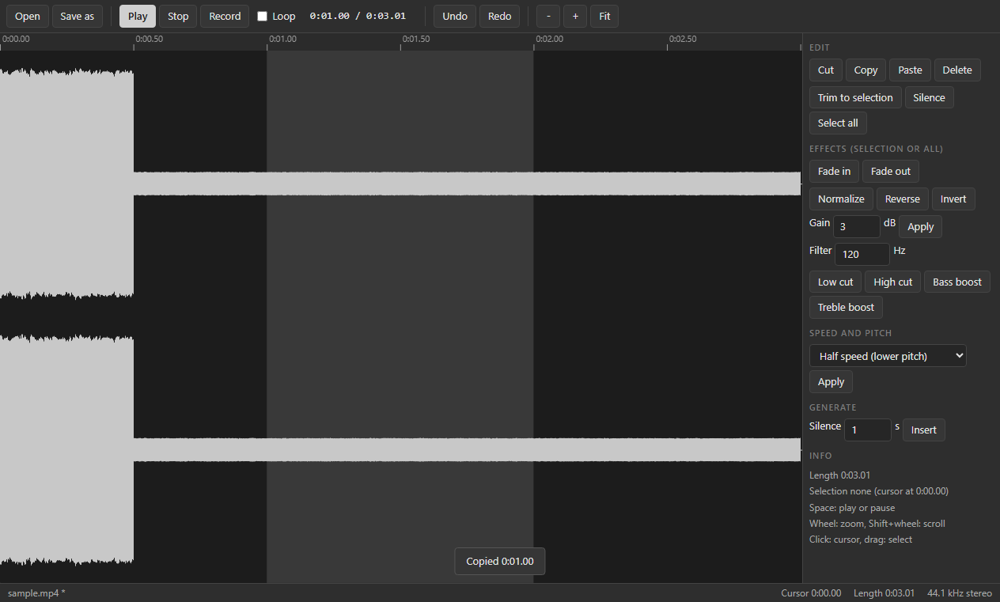

# Tuneout

A private audio editor for Windows. Open a sound or the soundtrack of a video, see the waveform, cut and tidy it, record your voice and save it in the format you need. No account, no subscription and no internet connection needed.

## What you can do

- **See the waveform** and zoom in to edit exact moments
- **Cut, copy, paste, delete, trim and silence** any selection, with undo and redo
- **Record** from your microphone straight into the project
- **Fade in and out, normalize, change volume, reverse and invert**
- **Cut low or high sounds**, boost bass or treble
- **Change speed and pitch**
- **Insert silence** where you need a pause
- **Save as** MP3, WAV, FLAC, M4A or Opus, the whole file or just the selection
- Opens MP3, WAV, FLAC, AAC, M4A, OGG, Opus, WMA and the audio of MP4, MKV, MOV, WebM and AVI

## Your files stay on your computer

Tuneout works entirely offline. There is no account, no upload and no tracking.

## Download

Get **Tuneout-Setup-1.0.0.exe** from the [Releases](../../releases/latest) page and run it.

Part of the [Lookout](https://github.com/plawanpawin-byte/Lookout) family of apps.

Released under the MIT License. Media processing uses FFmpeg, which is licensed under the GNU GPL.
