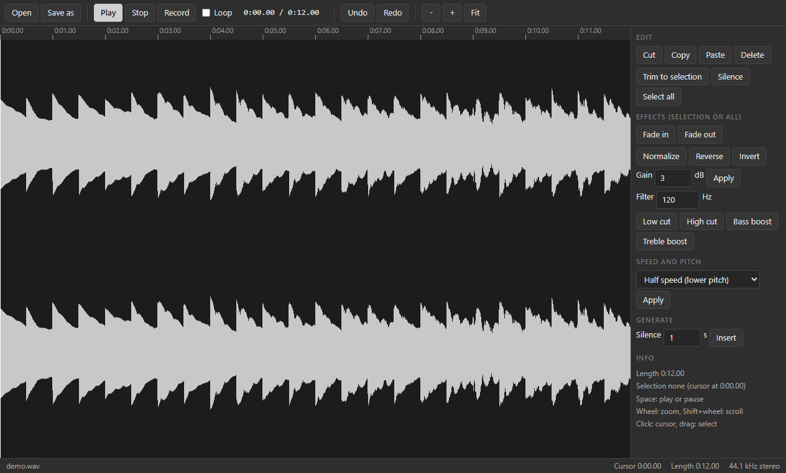
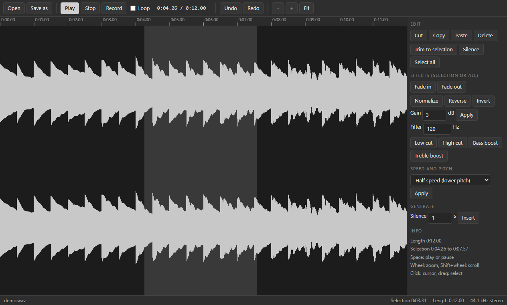
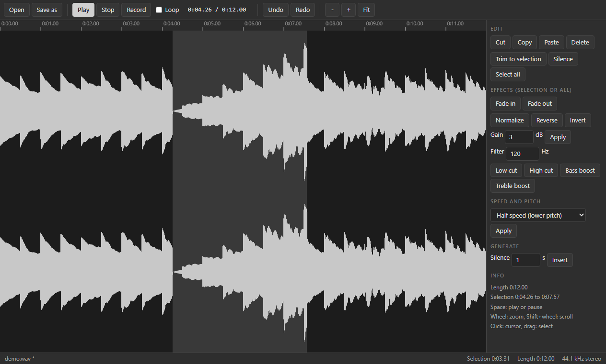
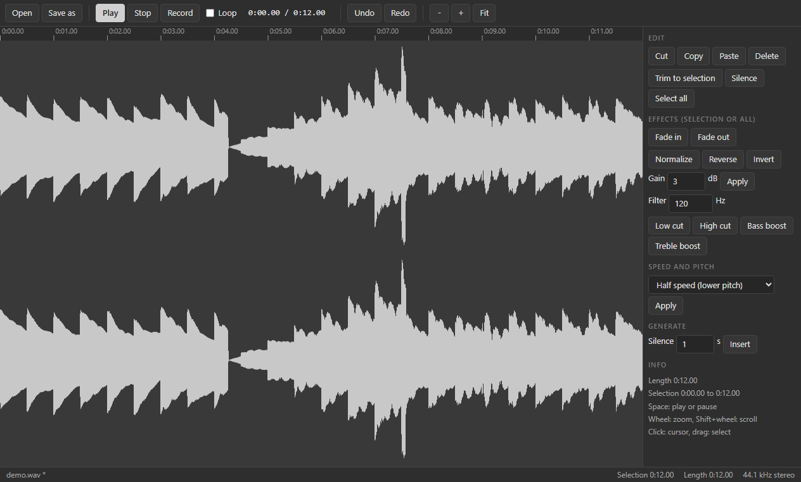
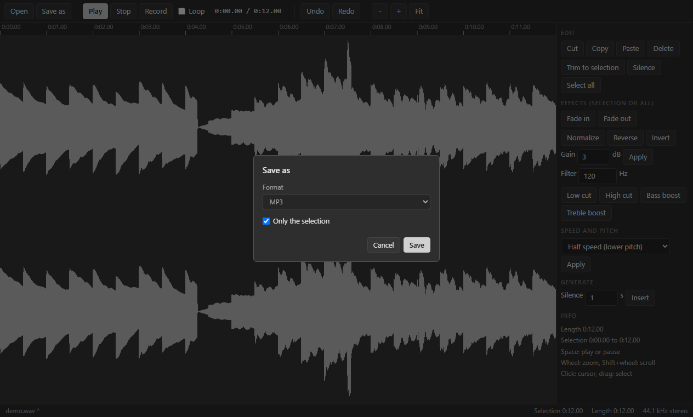

<b>Record and edit audio</b> Version 1.0.1 for Windows · Free · Offline · No account

<a href="https://github.com/plawanpawin-byte/tuneout/releases/latest"><b>Download Tuneout</b></a> · <a href="https://github.com/plawanpawin-byte/Lookout">All Lookout apps</a>

---

Tuneout is an audio editor. See your sound as a waveform, select a part with the mouse, then cut, copy, paste, fade, normalise, filter, change speed or record new audio. Save as WAV, MP3 and more.

**Made for:** Podcasts, voice notes, music clips, ringtones and cleaning up recordings.

## See it in action

### The waveform

Left and right channels drawn over a time ruler.

### Selecting audio

Drag across the waveform. The info panel shows the selection and total length.

### Fade and normalise

Effects apply to the selection, or to everything when nothing is selected.

### Filtering

Low cut, high cut, bass boost and treble boost at a frequency you choose.

### Saving

Choose the format and save.

## Everything it can do

### Edit

- Cut, copy, paste, delete, trim to selection and silence
- Select all, undo and redo

### Effects

- Fade in and out, normalise, reverse, invert
- Gain in decibels
- Low cut, high cut, bass and treble boost

### Speed and pitch

- Half speed, double speed and other presets

### Record and generate

- Record from the microphone
- Insert silence of any length

### View

- Zoom with the wheel, Fit, Shift + wheel to scroll
- Loop playback

### Files

- Opens MP3, WAV, FLAC, AAC, M4A, OGG, Opus and even the sound of a video
- Saves MP3, WAV, FLAC, AAC (M4A) and Opus

## How to use it

1. Click **Open** or **Record**.
2. Drag on the waveform to select a part.
3. Apply an effect from the right panel.
4. Press **Play** to hear the result.
5. Click **Save as**.

## Keyboard shortcuts

| Keys | What it does |
| --- | --- |
| Space | Play or pause |
| Ctrl + O / S | Open / save |
| Ctrl + X / C / V | Cut, copy, paste |
| Ctrl + A | Select all |
| Ctrl + Z / Y | Undo / redo |
| Delete | Delete the selection |
| Home | Go to the start |
| Wheel / Shift + wheel | Zoom / scroll |

## Files and formats

Opens MP3, WAV, FLAC, AAC, M4A, OGG, Opus, WMA and common video files. Saves MP3, WAV, FLAC, AAC and Opus.

## Private by design

- No account, no sign-in, no subscription, no ads.
- Tuneout works offline. It never uses the network.
- Files are opened and saved only through the Windows file dialogs you use. Tuneout cannot browse your disk on its own.
- The app window runs in a locked-down sandbox with a strict content policy.

## Install

1. Open the [latest release](https://github.com/plawanpawin-byte/tuneout/releases/latest) and download the file named **Tuneout-Setup-** followed by the version number and **.exe**. You can also install it from the [Lookout launcher](https://github.com/${OWNER}/lookout-launcher), which keeps it up to date.
2. Run the installer. It installs just for you, so it does not ask for administrator rights.
3. Windows may show a blue **Windows protected your PC** screen because these installers are not signed with a paid certificate. Click **More info**, then **Run anyway**.
4. Open Tuneout from the Start menu.

**Requirements:** Windows 10 or 11, 64-bit. About 500 MB of free disk space. No internet connection is needed to use the app.

## Questions

**Is editing destructive?**  
Edits happen in memory and can be undone until you save a file.

## About Lookout

Tuneout belongs to the **[Lookout](https://github.com/plawanpawin-byte/Lookout)** family: ten small, private Windows apps for documents and media, all with the same calm grey look and the same promise that your files stay yours. Install and update them together with the [Lookout launcher](https://github.com/plawanpawin-byte/lookout-launcher).

Released under the MIT License.
